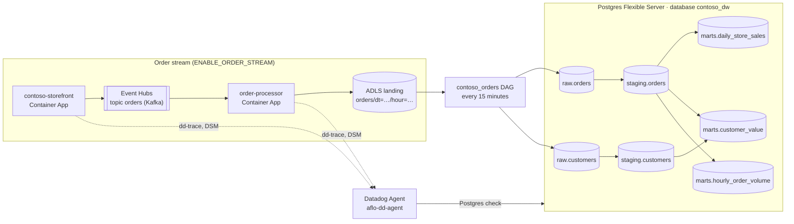

# Data pipeline demo: order stream to Postgres medallion, with Data Observability

This is an optional add-on to the main [Datadog for Airflow on ACA](../README.md)
setup. It gives the OpenLineage and OpenTelemetry instrumentation a realistic
workload: orders flow from a storefront, through Event Hubs and a landing zone, into
a Postgres medallion that Airflow builds.

- **Data Jobs Monitoring** shows the DAG with table-level lineage.
- **Data Observability** shows the same tables in its catalog, runs data quality
  monitors on them, and joins the lineage from the Kafka topic to the marts.
- **Data Streams Monitoring** shows the storefront → `orders` → order-processor
  pathway.

The pipeline doesn't change how Airflow is instrumented. It has two layers, each
behind its own switch:

| Switch | Adds |
|---|---|
| `ENABLE_DATA_PIPELINE` | The `contoso_dw` warehouse database, its DAGs, and a Datadog Agent with Data Observability for PostgreSQL. On its own, the DAG makes up its orders. |
| `ENABLE_ORDER_STREAM` | The storefront, Event Hubs, the order processor and the ADLS landing zone. The DAG then loads the landed orders instead. It needs `ENABLE_DATA_PIPELINE`. |



## What it adds

### The warehouse (`ENABLE_DATA_PIPELINE`)

| Piece | What it is |
|---|---|
| `contoso_dw` database | On the existing Postgres server, next to Airflow's `airflow` database. It holds the `raw`, `staging` and `marts` schemas (bronze, silver, gold). |
| `contoso_dw_bootstrap` DAG | Runs once after the deploy. It creates the schemas and tables, seeds 2,000 customers, and creates the read-only `datadog` role that Datadog's [PostgreSQL setup](https://docs.datadoghq.com/data_observability/quality_monitoring/transactional_databases/postgres/) asks for. The statements run on a raw cursor, so the role's password never reaches task logs or OpenLineage. |
| `contoso_orders` DAG | Every 15 minutes: load orders into `raw`, rebuild `staging`, check it, then rebuild three marts. |
| `aflo-dd-agent` Container App | A Datadog Agent (7.81 or later) running the Postgres check with `data_observability.enabled`. One replica only, so each monitor runs once. It's also the trace intake for the two stream services. |

**How Airflow gets the warehouse.** `AIRFLOW_CONN_CONTOSO_DW` holds the
`contoso_dw` connection, and both DAGs exist only when it's set. The connection's
host must be the server's FQDN. OpenLineage names Postgres tables with namespace
`postgres://{host}:{port}` and name `{database}.{schema}.{table}`, and the Agent's
check uses the same host. That way, Data Jobs Monitoring and the Data Observability
catalog refer to the same tables.

**How the Agent is set up.** The Agent writes its Postgres check config from
environment variables at startup, so the password stays in a Container Apps secret.
It has internal HTTP ingress on port 8126, which the stream services reach at
`http://aflo-dd-agent`. Airflow keeps using the managed OTel agent.

### The order stream (`ENABLE_ORDER_STREAM`)

| Piece | What it is |
|---|---|
| `aflo-storefront` Container App | [`services/storefront.py`](../services/storefront.py) produces about 20 orders a minute (`storefrontOrdersPerMinute`) to the `orders` topic. |
| Event Hubs namespace | Standard tier with one event hub, `orders` (2 partitions, 1 day of retention), used through its Kafka endpoint. Basic has no Kafka endpoint. |
| `aflo-order-processor` Container App | [`services/order_processor.py`](../services/order_processor.py) consumes `orders`, drops messages that aren't valid orders, and every 5 minutes writes a newline-delimited JSON batch to the landing zone. It commits its Kafka offsets only after the blob is written. |
| `stdl…` storage account | A small ADLS Gen2 account (hierarchical namespace) with the `landing` container. It's separate from the Airflow file share's account, so the `abfss://` names in lineage describe it accurately. |

Both services run the stock `python:3.12-slim` image. They install their packages at
startup and run code from the Airflow file share (`services/`), so there's no
image to build. The deploy workflow uploads `services/` and restarts both apps when it
changes.

**Why these two use dd-trace instead of OpenTelemetry.** Data Streams Monitoring
needs a Datadog SDK; OpenTelemetry can't produce DSM pathways. So the storefront and
the processor run under `ddtrace-run` with `DD_DATA_STREAMS_ENABLED=true`, and send
to the pipeline's Agent. This is the only part of the repo that uses a Datadog SDK.
For open-source languages, DSM supports Kafka and RabbitMQ (Azure Service Bus only
from .NET), which is why the stream uses Event Hubs' Kafka endpoint.

## Lineage

| Task or job | Reads | Writes | How it's reported |
|---|---|---|---|
| `order_processor.land_orders` | `kafka://<namespace>.servicebus.windows.net:9093` `orders` | `abfss://landing@<account>.dfs.core.windows.net` `orders` | The processor sends an OpenLineage run per batch, with the row count |
| `ingest_orders` (stream mode) | the landing zone | `raw.orders` | `LoadLandedOrdersOperator.get_openlineage_facets_on_complete` |
| `ingest_orders` (no stream) | | `raw.orders` | SQL |
| `ingest_customers` | | `raw.customers` | SQL |
| `staging_orders` | `raw.orders` | `staging.orders` | SQL |
| `staging_customers` | `raw.customers` | `staging.customers` | SQL |
| `check_staging` | `staging.orders` | | SQL |
| `mart_daily_store_sales` | `staging.orders` | `marts.daily_store_sales` | SQL |
| `mart_customer_value` | `staging.orders`, `staging.customers` | `marts.customer_value` | SQL |
| `mart_hourly_order_volume` | `staging.orders` | `marts.hourly_order_volume` | SQL |

"SQL" means `SQLExecuteQueryOperator` (or `SQLCheckOperator`): OpenLineage reads the
tables from the statements, with column-level lineage. The stream-mode load is
Python, so its operator reports its datasets itself, using the same names as the
processor and the Postgres provider.

[`tests/test_contoso_dw.py`](../tests/test_contoso_dw.py) checks the SQL rows with
`openlineage-sql`, the parser Airflow's OpenLineage provider uses.
[`tests/test_contoso_stream.py`](../tests/test_contoso_stream.py) checks that the
processor and the DAG name the landing zone the same way.

## Turn it on

You need:

- **Datadog Data Observability for PostgreSQL.** It's in Preview, so your Datadog
  rep enables it for the org.
- **Remote Configuration**, on the org and on the API key in `DD_API_KEY`. The
  monitors reach the Agent through it.

```bash
azd env set ENABLE_DATA_PIPELINE true
azd env set DD_POSTGRES_PASSWORD "$(openssl rand -hex 24)"
azd env set ENABLE_ORDER_STREAM true     # optional: the storefront and Event Hubs
azd provision
```

On the very first provision with the stream on, the two services can start before the
postprovision hook has uploaded their code, and exit. Restart them once the hook
finishes:

```bash
for app in aflo-storefront aflo-order-processor; do
  az containerapp revision restart -g <rg> -n "$app" \
    --revision "$(az containerapp show -g <rg> -n "$app" --query properties.latestRevisionName -o tsv)"
done
```

For the [deploy workflow](../README.md#continuous-deployment), add the same settings
to the `azure` GitHub environment. Without them, the next infra deploy turns them
off. The workflow refuses to run if `ENABLE_DATA_PIPELINE` is set but its password
isn't.

```bash
gh variable set ENABLE_DATA_PIPELINE --env azure --repo "$REPO" --body true
gh variable set ENABLE_ORDER_STREAM --env azure --repo "$REPO" --body true
azd env get-value DD_POSTGRES_PASSWORD | gh secret set DD_POSTGRES_PASSWORD --env azure --repo "$REPO"
```

## Check that it works

1. **The Agent sees the database and Remote Configuration.** Run the status command
   inside the Agent:

   ```bash
   az containerapp exec -g <rg> -n aflo-dd-agent --command "agent status"
   ```

   - In **Collector**, the `postgres` check shows `Total Runs` above zero, with no
     error.
   - In **Remote Configuration**, the status shows `Organization enabled: True` and
     `API Key: Authorized`.
2. **The tables are in the catalog.** Open Data Observability → Catalog, filtered to
   PostgreSQL. All the tables should be listed under the server's FQDN. In our deploy
   they showed up within minutes, but Datadog says to allow up to an hour.
3. **Lineage connects.** Anchor the lineage graph on `raw.orders`. The
   `contoso_orders` tasks should sit between the `raw`, `staging` and `marts` tables,
   with column-level edges. Each table is a single entity that both the Agent and
   Airflow's OpenLineage events report on. With the stream on, `raw.orders` has
   `ingest_orders`, then the landing zone's `orders` dataset, then the `orders`
   Kafka topic upstream of it. Datadog draws the processor's batches as the edge from
   the topic to the landing zone.

   The topic currently appears twice. Data Streams Monitoring reports one `orders`
   topic, with `contoso-storefront` producing to it. The processor's OpenLineage
   events report another, which feeds the landing zone. Datadog doesn't merge the
   two yet.
4. **The stream flows.** APM shows `contoso-storefront` (`kafka.produce`) and
   `order-processor` (`kafka.consume`), and Data Streams Monitoring shows the
   pathway between them through `orders`. The processor's log prints
   `landed N orders in orders/dt=…`.

## Monitors to create

Create these from a table's **Monitors** tab, under Add Monitor:

| Table | Monitor | What it catches |
|---|---|---|
| `raw.orders` | Row count | `volume_drop` and `skip_load` |
| `staging.orders` | Column metric: null ratio of `customer_id` | `null_customers` |
| `staging.orders` | Custom SQL (freshness, in minutes): `SELECT EXTRACT(EPOCH FROM now() - max(ordered_at)) / 60 AS dd_value FROM staging.orders` | `skip_load` |
| `marts.daily_store_sales` | Custom SQL: `SELECT count(*) AS dd_value FROM marts.daily_store_sales WHERE revenue_usd < 0` (alert above 0) | Bad amounts that get past the checks |

Schema changes on `raw.orders` (`schema_drift`) show up on the table's **Schema
Changes** tab.

**How often monitors run.** In our deploy, the first three monitors created
(nullness, freshness and negative revenue on the `staging` and `marts` tables)
each recorded a value within two minutes. None recorded a second value an hour
later. Monitors created after that, including row-count monitors on `raw.orders`
and `staging.orders` (built-in and custom SQL), still hadn't recorded anything
nine hours later. Removing `modelTypeOverride`, and creating a new monitor with a
plain threshold, didn't change that.

So don't count on a new monitor running right away, or on the default schedule
keeping up with the pipeline. `monitor_options.crontab_override` sets the
schedule. For a live demo, create the monitors the day before and confirm each
one shows a value before you present.

You can also create them with the monitors API, as type `data-quality alert`. The
table or column goes in `options.variables[]` by its Data Observability entity ID,
which you can copy from the catalog. This is the row-count monitor:

```json
{
  "name": "[contoso_dw] raw.orders row count",
  "type": "data-quality alert",
  "query": "formula(\"anomalies(query1)\").last(\"2h\") > 0",
  "options": {
    "variables": [{
      "name": "query1",
      "data_source": "data_quality_metrics",
      "filter": "search for database_table where `entity_id:<raw.orders entity id>`",
      "group_by": ["entity_id", "table", "schema", "database"],
      "measure": "row_count",
      "monitor_options": {},
      "schema_version": "0.0.1"
    }]
  }
}
```

For the other three, change the variable:

- **Null ratio:** `measure: "nullness"`, with the filter on the column (`search for
  database_column where ...`).
- **Custom SQL:** `measure: "custom"`, with `monitor_options.custom_sql` set to the
  query. Use a fixed threshold, such as `formula("query1").last("2h") > 45`, instead
  of `anomalies(...)`.

## Break it on purpose

Trigger `contoso_orders` from the Airflow UI with **Trigger DAG**, and switch on one
or more of the params below.

Avoid passing the config through `az containerapp exec --command`. It doesn't keep a
JSON argument intact: in our test, the run never started. If you need a shell, run
the trigger from Python inside the scheduler, so no shell parses the JSON:

```python
import json, subprocess
subprocess.run(["airflow", "dags", "trigger", "contoso_orders",
                "-c", json.dumps({"null_customers": True})], check=True)
```

| Param | Without the stream | With the stream (acts on the load) |
|---|---|---|
| `null_customers` | 30% of the generated orders have no `customer_id` | 30% of the loaded orders lose their `customer_id` |
| `volume_drop` | Only 5% of the usual orders are generated | Only 5% of each landed batch is loaded; the rest is lost |
| `skip_load` | No orders are generated | Nothing is loaded; the batches wait, and the next normal run catches up |
| `schema_drift` | `raw.orders` gains a `promo_code` column. A normal run drops it again. | The same |
| `interval_minutes` | The window the order timestamps fall in (default 15) | Not used |

In both modes, `staging.orders` carries the nulls, and `marts.customer_value` loses
those orders, because it joins on the customer. Scheduled runs use the defaults, so
the data recovers on the next scheduled run, about 15 minutes later.

## Optional: Storage Management for the landing zone

Datadog [Storage Management](https://docs.datadoghq.com/infrastructure/storage_management/azure_blob_storage/)
shows object counts, size and age for each prefix of the `stdl…` landing account. It
builds those from a daily Azure blob inventory report. It needs:

- **The Datadog Azure integration to use an App Registration**, not the Azure
  Marketplace (Datadog ISV) link.
- **A one-time script.** In Datadog, open **Storage Management → Azure Blob Storage →
  Enable buckets** and select the `stdl…` account. It generates a script for Cloud
  Shell. The script creates the inventory policy and the
  `datadog-storage-monitoring` container, and gives the integration's App
  Registration the Storage Blob Data Reader role on that container. That role
  assignment needs Owner or User Access Administrator, which is why the deploy
  doesn't do it.
- **Confirming in the same Datadog page.** Metrics arrive 24 to 48 hours later.

## Cost

Rough monthly list prices, always on:

| Piece | Approx. |
|---|---|
| `aflo-dd-agent` (0.5 vCPU, 1 GiB) | $25–35 |
| Storefront and processor (0.25 vCPU, 0.5 GiB each) | $20–30 |
| Event Hubs Standard, 1 throughput unit | ~$22 |
| Landing storage account | Cents |
| `contoso_dw` | No extra server. `raw.orders` keeps 14 days of orders, about 400k rows. |

To pause the stream between demos, deactivate the two services' revisions
(`az containerapp revision deactivate`) and activate them again later. Event Hubs
keeps a day of orders, so the processor catches up when it comes back.

Turning a switch off later doesn't delete what it created, because the deployment
is incremental. It only removes the pipeline settings from the Airflow apps. Delete
the leftover resources by hand: the Agent and stream apps, the Event Hubs namespace,
the `stdl…` storage account, and the `contoso_dw` database.
